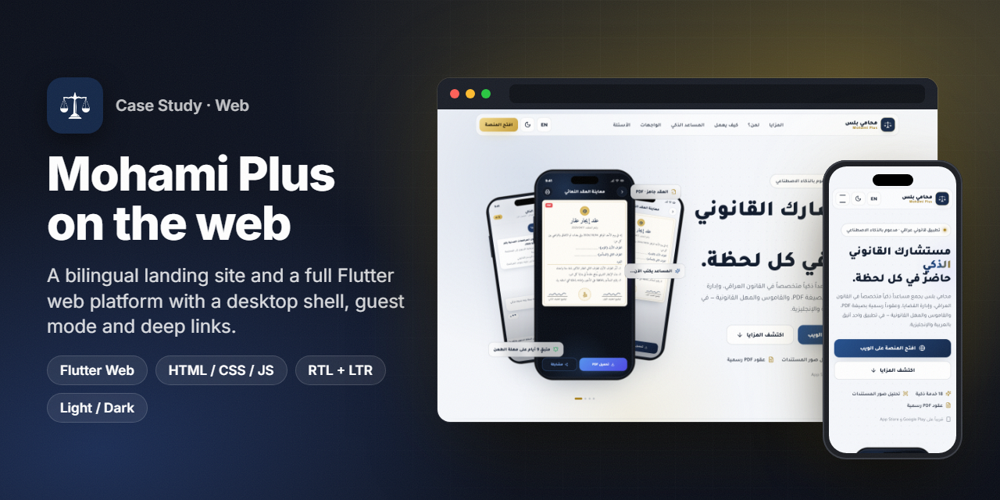
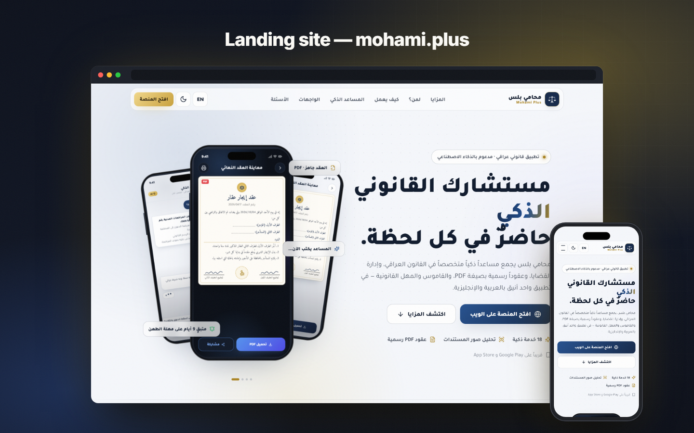
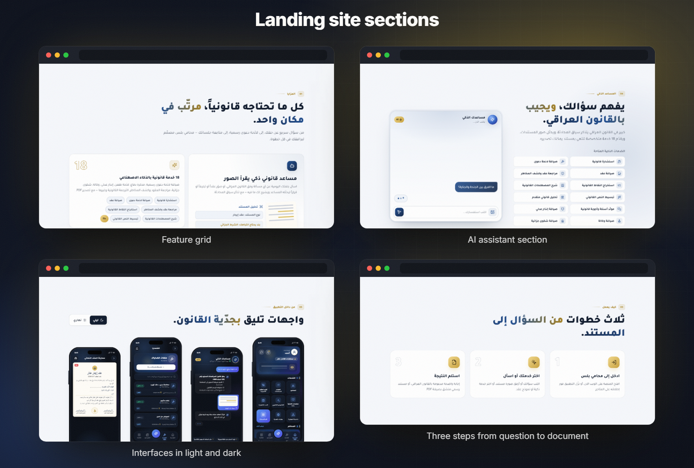
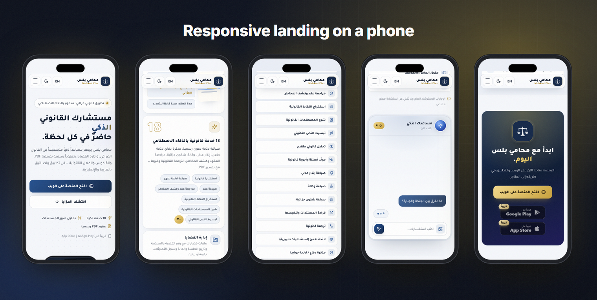
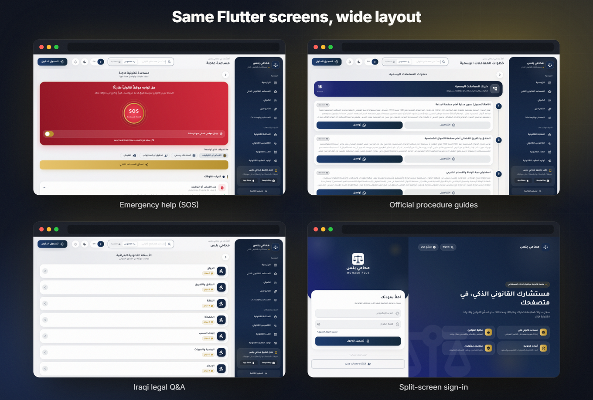
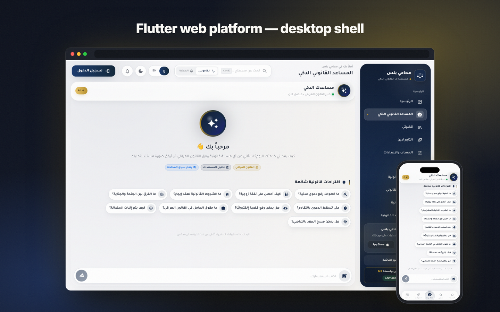
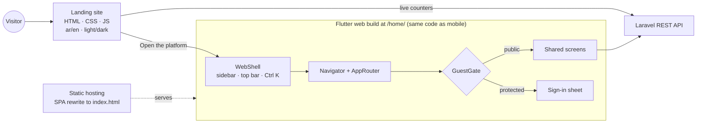

<h1 align="center">Mohami Plus — Web</h1>

<b>A bilingual marketing site plus a full Flutter web platform with a desktop shell, built from the same codebase as the mobile app.</b>

  
  
  
  
  
  
  

> ℹ️ This is a case study. The source code belongs to the client and is not included.

## Overview

[Mohami Plus](https://github.com/ANaSHaker/mohami-plus-app-case-study) is an AI legal assistant for Iraq. This case study covers its two web surfaces, both of which I built in October 2026:

1. **The landing site** at [mohami.plus](https://mohami.plus). It is hand-written HTML, CSS and vanilla JS with no framework, in Arabic and English, with light and dark themes. It reads live content counters from the API.
2. **The web platform** at [mohami.plus/home](https://mohami.plus/home/). This is the Flutter app compiled for the web. It wraps every mobile screen in a desktop shell with a sidebar, a top bar and a command search. Visitors can browse public content as guests.

Both share the brand, the copy and the backend with the mobile app.

## The challenge

- **One codebase, two form factors.** The Flutter app was designed for phones. On a 1440 px monitor it had to feel like a real desktop product, not a stretched phone, without forking 70 screens.
- **Visitors who don't have an account.** On mobile the app asks you to sign in first. On the web, people arrive from search and links, so they need to read content first and be asked to sign in only when they act.
- **Deep links on a static host.** The web app lives under `/home/` on shared hosting. Short links such as `/home/faq` and `/home/privacy` had to work, and so did refreshes on any route.
- **A landing page that never lies.** The counters on the page (AI services, contracts, courts, dictionary terms) had to come from the real database, not be hard-coded.

## Highlights

**🖥️ Flutter web platform**
- A **desktop shell** that wraps the whole `Navigator`. It has a collapsible sidebar, a top bar with search (Ctrl/⌘ K), a language toggle, a theme toggle and notifications. Content sits in a floating card at most 1280 px wide.
- Below 1000 px the shell steps aside, and the user gets the exact mobile UI.
- **Guest mode.** Public screens open freely. Protected routes are swapped for a "sign in to continue" sheet, both in `onGenerateRoute` and in the network interceptor.
- A split-screen sign-in page and an app-download card in the sidebar.
- Path URLs, browser back and forward support, and short aliases for the landing footer: `/faq`, `/privacy`, `/terms`.

**🌐 Landing site**
- Arabic RTL and English LTR from a small `i18n.js` dictionary. Light and dark themes, with the user's choice remembered.
- Live counters from the public API, fetched with an abort timeout and a graceful fallback.
- Sections: features, audience (citizens, lawyers, companies), how it works, the AI assistant, app screens in light and dark, FAQ, download and contact.
- In-page phone mockups drawn in HTML and CSS (`screens.js`), so the hero stays sharp at any size.
- SEO basics: a meta description, `sitemap.xml`, `robots.txt` and a web manifest.

## Screens

Landing site, desktop and phone.

Flutter web platform: emergency help, procedure guides, Iraqi legal Q&amp;A and the split-screen sign-in.

> All images are real captures of the site and the Flutter web build, rendered with headless Chrome at 1440 × 900 (desktop) and 390 × 844 (phone).

## Signature feature: one Flutter app, a real desktop shell

The shell is installed once, in `MaterialApp.builder`. Every route the app already had renders inside its content area, so no screen was rewritten for the web:

- The content card gets its own `MediaQuery`. Screens built for phones lay out against the card's width, not the window's.
- The sidebar groups the app's sections (main, tools, account) and highlights the current route.
- Keyboard shortcuts work: Ctrl/⌘ K focuses the global search, which looks up legal terms or the library.
- On narrow windows (< 1000 px) or mobile browsers, the shell returns its child untouched, so phones get the native mobile layout.

## Architecture & stack

| Layer | Technology |
|---|---|
| Landing | Semantic HTML5, a single CSS file (about 880 lines), vanilla JS (`main.js`, `i18n.js`, `screens.js`) |
| Web app | Flutter web (CanvasKit), built with `--base-href /home/`, path URL strategy |
| Web-only code | `WebShell`, `WebNav`, `WebAuthFrame`, `GuestGate`, conditional imports (`web_bridge_web.dart` / `_io.dart`) |
| Hosting | Static files with an SPA rewrite rule and forced HTTPS |
| Data | The same REST API as the mobile app; public endpoints for counters, FAQ and legal pages |

## Engineering notes

- **Conditional imports for web-only APIs.** Browser features such as file download and opening URLs sit behind a `web_bridge` facade with `_web` and `_io` implementations. The mobile build never pulls in `dart:html`.
- **A deep-link trap, documented.** The SPA rewrite file is copied into every build. Once, a stale copy pointed at an old base path and broke deep links. The base path now lives in one place and is checked on every deploy.
- **Stale caches after a rename.** Translation files moved from `assets/languages/` to `assets/i18n/` to bust aggressive browser caches after a big i18n update. Users got fresh strings without hard-refreshing.
- **Honest numbers.** The landing page only shows counters returned by the API. If the request fails or times out, the section degrades quietly instead of showing invented numbers.
- **Light by default, dark on request.** Every surface (landing, web app, dashboard) starts in light mode and remembers the user's choice. The dark palette is derived from the same brand tokens.

## Results

- Both surfaces are live: [mohami.plus](https://mohami.plus) (landing) and [mohami.plus/home](https://mohami.plus/home/) (web platform).
- At the time of writing, the landing page showed **18 AI services, 28 contract templates, 59 courts and 233 dictionary terms**, all read live from the API.

## بالعربي

واجهتا الويب لمنصة **محامي بلس**: موقع تعريفي بالعربية والإنجليزية بوضعين فاتح وداكن، وأرقامه تُقرأ مباشرة من قاعدة البيانات.
ومنصة ويب كاملة مبنية من كود تطبيق Flutter نفسه، بواجهة سطح مكتب فيها قائمة جانبية وشريط علوي وبحث سريع (Ctrl K).
يتصفح الزائر المحتوى العام بدون حساب، ويُطلب منه تسجيل الدخول فقط عند تنفيذ إجراء.
روابط مباشرة لكل صفحة، ودعم كامل لزر الرجوع في المتصفح، والعربية والإنجليزية.

## Links

- 🌐 Landing: [mohami.plus](https://mohami.plus)
- 🖥️ Web platform: [mohami.plus/home](https://mohami.plus/home/)
- 📱 Mobile app case study: [mohami-plus-app-case-study](https://github.com/ANaSHaker/mohami-plus-app-case-study)

---
<h3 align="center">Built by Mahmoud Shaker — Senior Flutter Engineer</h3>

  
  
  
  
  
  
  

